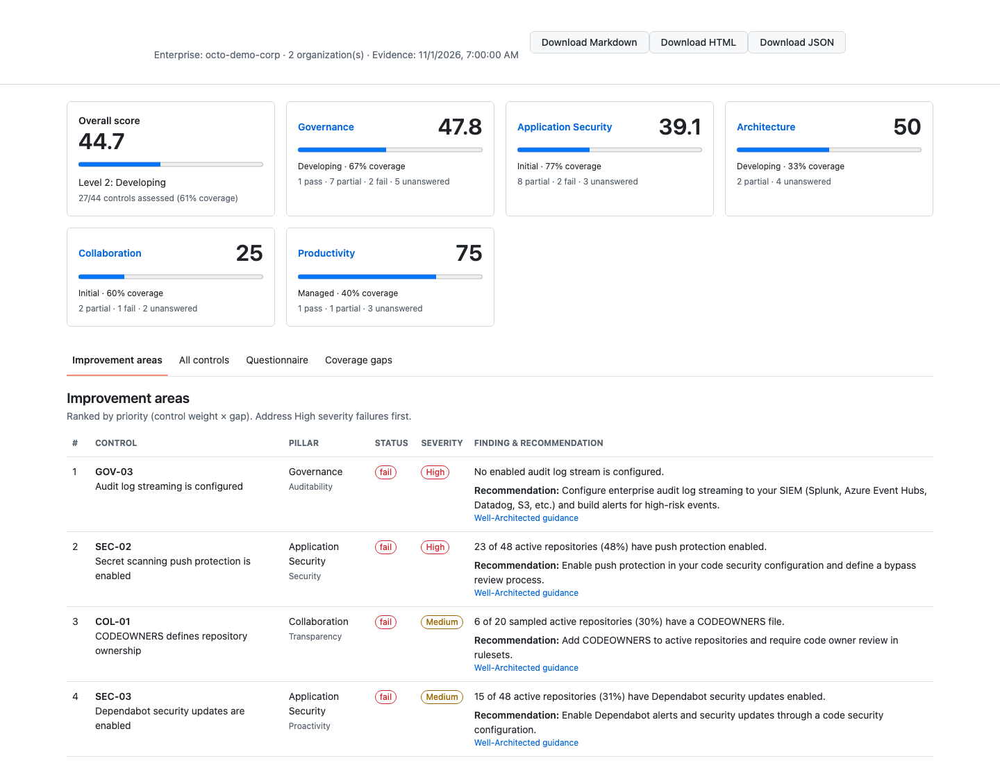

# GitHub Enterprise Assessment

A local dashboard and CLI for identifying improvement opportunities in a GitHub enterprise. It combines read-only GitHub API evidence with an assessor questionnaire and produces prioritized reports aligned with the [GitHub Well-Architected Framework](https://learn.github.com/well-architected).

This is an independently defined rubric and maturity model, not an official GitHub certification or a comprehensive security audit. Results are indicators for human review, not proof of compliance.

Read the [user guide](https://beardofedu.github.io/github-enterprise-assessment/) for a screenshot walkthrough, setup, and troubleshooting, or browse the [changelog](https://beardofedu.github.io/github-enterprise-assessment/changelog.html).



## Requirements

- Node.js 20 or later.
- npm, to install and serve the dashboard's local Primer CSS.
- For live collection, a GitHub token or an authenticated [GitHub CLI](https://cli.github.com/) session. The app uses `GH_TOKEN`, then `GITHUB_TOKEN`, then `gh auth token`.

Install the dependencies in the application directory before starting the dashboard or generating HTML reports:

```sh
npm ci
```

If Primer CSS is missing, the dashboard stops with this instruction instead of displaying an unstyled page. Restart the dashboard after installing dependencies.

## Try the demo

```sh
npm run demo
```

Open the displayed local URL. The demo uses fictional evidence and saves questionnaire answers to `answers.demo.json`. Press Ctrl+C to stop the server.

## Assess an enterprise

```sh
gh auth login
node bin/gh-waf-assess.js run --enterprise YOUR_ENTERPRISE_SLUG
```

The command collects evidence into `evidence.json`, starts a dashboard on `http://127.0.0.1:4173`, and saves answers to `answers.json`. Complete the questionnaire to assess controls that cannot be determined from the API.

Existing answers in `answers.json` are loaded automatically when the dashboard starts. Use `--answers path/to/answers.json` with `run` or `serve` to load and continue saving to another file.

You can also select **Load answers.json** in the dashboard to start from a saved answers file. Imports update matching answers and notes, keep other answers and collected evidence, and save to the dashboard's configured answers file. Files must be JSON objects keyed by control ID (not exported assessment reports), no larger than 64 KiB. Each value may be `"yes"`, `"partial"`, `"no"`, or `"na"`, or an object such as `{ "answer": "partial", "notes": "Review in progress" }`; notes are limited to 4,000 characters. See [`examples/answers.example.json`](examples/answers.example.json). Invalid imports are rejected without changing existing answers.

To collect and report separately:

```sh
node bin/gh-waf-assess.js collect --enterprise YOUR_ENTERPRISE_SLUG --out evidence.json
node bin/gh-waf-assess.js serve --evidence evidence.json
node bin/gh-waf-assess.js assess --evidence evidence.json --answers answers.json --format md --out reports/assessment.md
node bin/gh-waf-assess.js assess --evidence evidence.json --answers answers.json --format html --out reports/assessment.html
```

Reports can also be downloaded from the dashboard. HTML reports include Primer CSS so they retain their styling when opened offline. Use `--format json` for machine-readable output, and `--fail-under N` to exit with code 2 when the overall score is below a threshold. See `node bin/gh-waf-assess.js --help` for all options.

## Access and coverage

Use an identity with access to the enterprise and its organizations. Enterprise-owner and organization-owner permissions may be needed for administrative settings; repository and security-alert visibility also depends on the identity's access. For a classic personal access token or `gh` OAuth token, scopes such as `read:enterprise`, `read:org`, `repo`, `security_events`, and `read:audit_log` may be needed depending on the checks and repositories. Enterprise audit-log streaming endpoints require a classic token with `read:audit_log`. Authorize the token for SAML SSO where required.

Start with the least access appropriate for your assessment. Limited access, unsupported API fields, and failed requests become coverage gaps rather than failures. Review the dashboard's coverage gaps and the discovery warning before interpreting scores. When a gap is caused by a missing token scope, the dashboard and Markdown report show a copyable `gh auth refresh` command with the required scopes. A fine-grained token or GitHub App installation token may cover a subset of endpoints; GitHub App authentication is not implemented by this tool.

By default the collector discovers organizations through the enterprise API. If the enterprise is not available to the authenticated token (wrong slug, missing `read:enterprise` scope, not an enterprise member, or SSO not authorized), collection stops with an error. In an interactive terminal you are asked whether to collect the organizations visible to the token instead; otherwise the tool prints steps for granting enterprise access (for example `gh auth refresh -s read:enterprise,read:org`). Pass `--use-token-orgs` to fall back to token-visible organizations without prompting, which may not match the enterprise. Use `--orgs org-one,org-two` to specify scope explicitly. Repository inventory is capped at 1,000 per organization and deep inspection samples 25 active repositories by default; adjust these with `--max-repos` and `--sample`. Samples and truncated inventories are not comprehensive.

For GitHub Enterprise Server, supply `--api-url https://HOST/api/v3` and authenticate with a token for that host. API availability differs by version, so some checks may be unavailable.

## Rubric and scoring

The bundled rubric has 44 controls: 15 Governance, 13 Application Security, 6 Architecture, 5 Collaboration, and 5 Productivity. Controls use automated evidence or manual answers, with references and suggested remediation. List them with:

```sh
node bin/gh-waf-assess.js rubric
```

Pass, partial, and fail are scored as 1, 0.5, and 0, weighted by control importance. Unknown, unanswered, and not-applicable controls are excluded from scores; coverage shows the percentage of applicable controls that were scored. A high score with low coverage is not a complete assessment. The maturity labels are Initial (<40), Developing (40–59.9), Defined (60–74.9), Managed (75–89.9), and Optimized (90–100).

Select a pillar summary card to open All controls filtered to that pillar. Any existing status filter is retained; the card's guidance link opens the Well-Architected checklist.

Select an automated finding to see its collected repository or organization results. Unavailable settings and unsampled repositories are marked as not assessed; the list identifies truncated or unavailable inventories. Use **Export .md** in the results dialog to download the grouped list as a Markdown file named for the control.

To customize controls or scoring, copy `rubric/well-architected.json` and pass `--rubric path/to/rubric.json`. New automated controls also require a matching check implementation in `src/checks.js`.

Use **Download task** on a finding or coverage gap to export a Markdown implementation task with its recommendation, references, and a review checklist. The dashboard and collector are read-only and do not change GitHub settings; follow [`docs/implementation-guide.md`](docs/implementation-guide.md) and review the [daily official updates digest](docs/official-updates.md) before applying changes. A scheduled GitHub Actions workflow refreshes that digest from the GitHub Docs source repository, Changelog, and Blog each day.

## Privacy

The dashboard binds to loopback and the collector only makes read-only GitHub API requests. Evidence, answers, assessment JSON, and exported reports can contain repository and organization names, sensitive enterprise configuration, and assessor notes; keep them secure and do not commit them. Default output filenames are ignored by Git, but custom output paths may not be.

## Primer and accessibility

The dashboard uses locally served Primer CSS, Primer component styles and color tokens, semantic landmarks and headings, labeled form controls, visible keyboard focus, responsive layouts, and accessible status and tab interactions. Use the header selector to choose System, Light, Dark, High contrast, or Colorblind; the browser saves this preference locally when available. The selector is also available in exported HTML reports. Its accessibility test checks Primer styling and header contrast, including offline HTML reports. It also runs axe after saving a questionnaire answer and at a narrow viewport, and checks keyboard navigation. Automated checks are guardrails, not a substitute for human review with keyboard-only interaction, browser zoom, VoiceOver/Safari, and NVDA/Chrome.

## Development

```sh
npm test
npm run test:a11y
```

The accessibility test requires Playwright's Chromium browser. If it is not installed yet, run `npx playwright install chromium`.

### Documentation site

The static user guide and changelog live in [`docs/index.html`](docs/index.html) and [`docs/changelog.html`](docs/changelog.html). Open the HTML locally to preview; no site generator is required. Add user-facing changes to the changelog with links to the affected guide sections. Keep project changes separate from the upstream official updates digest.

Run `npm run docs:screenshots` to refresh the four walkthrough screenshots from bundled fictional evidence and example answers. This requires Playwright Chromium, uses loopback port 4174, and cleans up its temporary answers. Never capture live enterprise data for the public site. Run `npm run test:docs` to check local links, screenshots, accessibility, and desktop/mobile reflow.

In repository **Settings > Pages**, select **GitHub Actions** as the build source. The Documentation site workflow checks pull requests and deploys after changes merge to `main` (or a manual run on `main`). Only the explicitly staged HTML, CSS, and demo screenshots are published, not assessment outputs. The first deployment must finish before the documentation URL is available.

## Community

Contributions are welcome; see the [contribution guide](CONTRIBUTING.md) and
[Code of Conduct](CODE_OF_CONDUCT.md). Read the [accessibility statement](ACCESSIBILITY.md)
and [security policy](SECURITY.md) for reporting guidance.

This project is available under the [MIT License](LICENSE).
